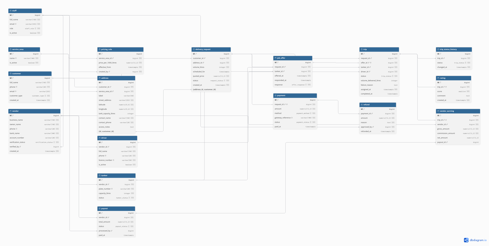

# Portfolio 1: Database Design and Modelling

This portfolio presents the relational design for **AquaFlow Water Tanker Services**, the case study described in the [root README](../README.md). It covers the entity-relationship model, keys and constraints, and the normalisation analysis that shaped the final design.

## Files

| File | Description |
|---|---|
| `aquaflow.dbml` | ER model in DBML, rendered with [dbdiagram.io](https://dbdiagram.io) |
| `aquaflow-er-diagram.png` | Exported ER diagram |
| `schema.sql` | PostgreSQL implementation of the design *(to be added)* |

## ER Diagram



## Entities

The model contains 17 tables, grouped by business area.

| Area | Tables | Purpose |
|---|---|---|
| Locations and pricing | `service_area`, `pricing_rule` | Zones served on Lagos Island and the price per 1,000 litres in each zone over time |
| Customers | `customer`, `address` | Households and businesses, and the delivery addresses where their storage tanks are located |
| Vendors and fleet | `vendor`, `driver`, `tanker` | Independent tanker owners, the drivers they employ, and the trucks they own |
| Requests and trips | `delivery_request`, `job_offer`, `trip`, `trip_status_history` | A customer's request, the offers sent to nearby tankers, the trips that result, and every status change along the way |
| Money | `payment`, `refund`, `vendor_earning`, `payout` | Customer payments, refunds, what each vendor earns per completed trip, and the payouts that settle those earnings |
| Feedback | `rating` | Customer rating of a completed trip |
| Staff | `staff` | Operations and finance users who set prices, verify vendors, approve refunds, and release payouts |

## Key Relationships

- A customer has many addresses, and each address belongs to exactly one service area.
- A vendor owns many tankers and employs many drivers.
- A delivery request is offered to many tankers through job offers. Each tanker is offered a given request at most once.
- A request can have many trips, because a failed trip can be retried by another vendor, but **only one trip per request can be active or completed**.
- A trip uses one tanker and one driver, and records every status change in `trip_status_history`.
- A request has at most one payment, taken only after successful delivery. A payment can have several refunds.
- Each completed trip produces exactly one vendor earning and at most one rating. A payout settles many earnings at once.
- Staff are linked to the actions they authorise: creating pricing rules, verifying vendors, approving refunds, and processing payouts.

## Keys and Constraints

**Primary keys.** Every table uses a surrogate `bigint` identity key. Natural identifiers such as phone numbers and plate numbers can change (a customer changes phone number, a tanker is re-registered), and using them as primary keys would force updates to cascade through every referencing table.

**Unique constraints on natural identifiers.** Although not primary keys, real-world identifiers are still enforced as unique: customer phone and email, driver phone and licence number, tanker plate number, staff email, and payment gateway reference. This prevents duplicate registrations and double-recorded payments.

**Foreign keys.** All relationships are enforced with foreign keys. Two are worth highlighting:

- **Composite foreign key on `delivery_request`.** The pair `(address_id, customer_id)` references `(id, customer_id)` in `address`. A simple foreign key on `address_id` alone would allow a request to link one customer to another customer's address. The composite key makes this impossible.
- **Required versus optional staff links.** `pricing_rule.created_by` and `refund.approved_by` are `NOT NULL`, because a price or refund cannot exist without someone authorising it. `vendor.verified_by` and `payout.processed_by` are nullable, because a vendor exists before verification and a payout exists before it is released.

**One-to-one relationships** are enforced with unique foreign keys: one payment per request, one earning per trip, one rating per trip, and one trip per accepted job offer.

**Partial unique index on `trip`.**

```sql
CREATE UNIQUE INDEX one_live_trip_per_request
ON trip (request_id)
WHERE status NOT IN ('failed', 'cancelled');
```

This allows any number of failed or cancelled trips for a request, but at most one trip that is active or completed. It enforces two business rules at once: a request can only be fulfilled once, and two vendors cannot be assigned the same request at the same time. Portfolio 3 demonstrates this index resolving a concurrent acceptance race.

**Check constraints** (implemented in `schema.sql`): volumes, capacities, prices, and amounts must be greater than zero, and rating scores must be between 1 and 5.

**Data types.** Monetary values use `numeric(12,2)` rather than floating-point types, because floats cannot represent decimal amounts such as 0.10 exactly and accumulate rounding errors in financial totals. Timestamps use `timestamptz` so times are stored unambiguously regardless of server timezone.

## Normalisation

The design was checked against First, Second, and Third Normal Form, and against Boyce-Codd Normal Form. This analysis led to two changes to the initial model, and two deliberate exceptions, which are documented below.

### First Normal Form (1NF)

A table is in 1NF when every column holds a single atomic value and there are no repeating groups.

All tables satisfy 1NF. For example, a customer with several delivery locations has several rows in `address` rather than columns such as `address1` and `address2`. Likewise, a trip's status changes are stored as separate rows in `trip_status_history` rather than as a list in one column.

### Second Normal Form (2NF)

A table is in 2NF when it is in 1NF and no non-key column depends on only part of a composite key.

Because every table uses a single-column surrogate primary key, partial dependency on the primary key cannot occur. The meaningful check is on composite candidate keys. `job_offer` has the natural key `(request_id, tanker_id)`. Its columns, such as `response` and `offered_at`, describe the offer of that specific request to that specific tanker, so they depend on the whole key. The tanker's capacity is deliberately **not** copied into `job_offer`, because it would depend on `tanker_id` alone, which would violate 2NF.

### Third Normal Form (3NF)

A table is in 3NF when it is in 2NF and no non-key column depends on another non-key column (no transitive dependencies).

The design stores references rather than copied descriptive data. An address stores `service_area_id`, not the area's name. A trip stores `tanker_id`, not the vendor's name or the tanker's plate number.

Reviewing the initial model for transitive dependencies found two problems, which were fixed:

1. **`delivery_request` stored both `customer_id` and `address_id`.** Since each address already belongs to a customer, `customer_id` is functionally dependent on `address_id`. Rather than removing the column, which is useful for querying a customer's requests directly, consistency is enforced with the composite foreign key described above, so the two values can never contradict each other.
2. **`vendor_earning.net_amount` was a derived value**, always equal to `gross_amount - commission_amount`. Storing it independently risked the values drifting apart. It is now a PostgreSQL generated column, computed by the database and impossible to update directly:
   ```sql
   net_amount numeric(12,2) GENERATED ALWAYS AS (gross_amount - commission_amount) STORED
   ```

### Boyce-Codd Normal Form (BCNF)

A table is in BCNF when every determinant is a candidate key. In each table, the only columns that determine other columns are the primary key and the natural identifiers enforced as unique (for example, a customer's phone number determines the rest of the customer row, and it is itself a candidate key). The design therefore also satisfies BCNF, with the two documented exceptions below.

### Deliberate Exceptions

Two columns intentionally store values that could be derived from other tables. Both record **historical facts** that must not change when related data changes later.

- **`delivery_request.quoted_price`.** The price could be calculated from the area's current `pricing_rule`, but prices change over time. A request must keep the price the customer was actually quoted, even after a new pricing rule takes effect.
- **`vendor_earning.vendor_id`.** The vendor can be derived through `trip → tanker → vendor`. However, if a vendor sells a tanker to another vendor, earnings from earlier trips must still belong to the original owner. Storing the vendor at the time of the trip preserves this, and also simplifies payout queries.

### Known Limitation

One business rule cannot be expressed with standard foreign keys: **a trip's driver and tanker must belong to the same vendor.** Both are valid foreign keys individually, but the database cannot compare their vendors without a trigger. This rule is enforced inside the trip-assignment transaction, which is covered in Portfolio 3.

## How This Was Produced

The entities, relationships, and business rules were defined from the case study requirements. The ER model was written in DBML and rendered with dbdiagram.io. The normalisation review was carried out against the initial model, and the resulting fixes were applied to the DBML before the diagram was exported.


## Testing

The schema was run on PostgreSQL 16 in Docker (see `docker-compose.yml` in the repository root). `constraint-tests.sql` verifies that the business rules are enforced by the database itself rather than relying on application code. It contains 15 tests, each stating its expected outcome, covering the composite foreign key, the partial unique index on trips, state-dependent CHECK constraints, the generated `net_amount` column, and unique natural identifiers. All tests run inside a transaction that is rolled back, so the script leaves the database unchanged and can be rerun. Output screenshots are in `screenshots/`.
