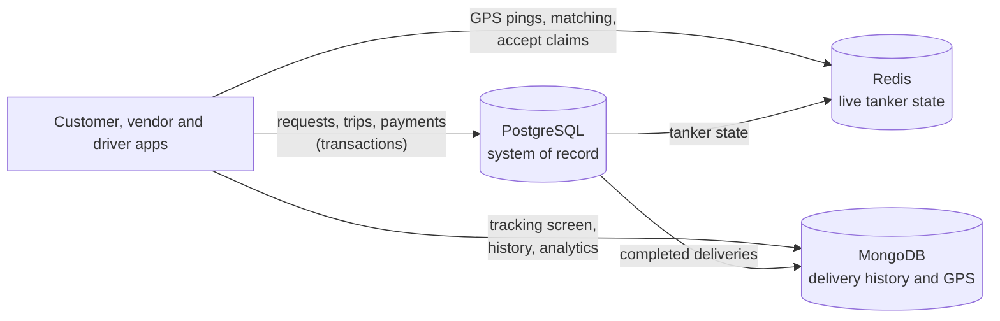

# Portfolio 4: NoSQL and Advanced Data Models

Portfolios 1 to 3 built AquaFlow on PostgreSQL, which remains the right home for its core records: customers, vendors, requests, trips and money, where constraints and transactions protect correctness. This portfolio identifies two parts of the system whose access patterns fit the relational model poorly, and moves each to a data model designed for that pattern:

- **Live tanker tracking and matching** in **Redis**, a key-value store
- **Delivery tracking history and GPS routes** in **MongoDB**, a document store with a time-series collection

The approach is *polyglot persistence*: each store is used for the job it does best, with PostgreSQL as the system of record and the NoSQL stores holding data derived from it.

## Files

| File | Description |
|---|---|
| `redis/redis-demo.sh` | Loads live tanker state and runs the Redis demonstrations |
| `redis/load-tankers.sql` | Generates Redis commands from PostgreSQL tanker data |
| `redis/match.lua` | Tanker matching, run atomically inside Redis |
| `redis/redis-demo-output.txt` | Output of the Redis demonstration |
| `mongo/mongo-demo.sh` | Creates the collections, imports data and runs the MongoDB demonstrations |
| `mongo/setup.js` | Collections, `$jsonSchema` validator, indexes and the time-series collection |
| `mongo/export-deliveries.sql` | Builds delivery documents from PostgreSQL as Extended JSON |
| `mongo/export-positions.sql` | Generates GPS routes for recent trips |
| `mongo/queries.js` | The MongoDB demonstration queries |
| `mongo/mongo-demo-output.txt` | Output of the MongoDB demonstration |

## Setup and Reproduction

Redis 7.2 and MongoDB 7.0 were added to `docker-compose.yml` in the repository root alongside PostgreSQL. With all three containers running and the database seeded:

```bash
docker compose up -d
bash portfolio-4-nosql/redis/redis-demo.sh
bash portfolio-4-nosql/mongo/mongo-demo.sh
```

Both scripts rebuild their data from PostgreSQL on every run.

## Architecture



PostgreSQL holds the authoritative data. Redis holds state that changes every few seconds and is only meaningful *now*. MongoDB holds a read-optimised copy of each delivery's full story. In this portfolio the copies are built by export scripts. In production they would be fed continuously, for example by publishing an event whenever a trip changes, or by change data capture from the PostgreSQL write-ahead log.

---

## Part A: Redis for Live Tanker Tracking

### Why the relational model fits poorly

Every tanker on the road reports its position every few seconds. With around 940 tankers on the road, that is hundreds of tiny writes per second, each overwriting the previous value, which is only interesting until the next ping. In PostgreSQL, each update creates a new row version, writes to the write-ahead log for durability, and leaves an old version for vacuum to clean up, all to store a value that will be replaced seconds later.

The most frequent read is "which available tankers are nearest to this customer?". PostgreSQL has no built-in geospatial index without the PostGIS extension, so the plain version computes the distance to every tanker on each request.

Redis keeps all data in memory, offers native geospatial commands, and lets keys expire automatically, which matches this workload closely.

### Data model

| Key | Redis type | Contents |
|---|---|---|
| `tanker:{id}` | Hash | Plate, vendor, capacity, status, latest coordinates |
| `geo:tankers` | Geo set | Latest position of every tanker on the road |
| `geo:tankers:available` | Geo set | Positions of available tankers only, used for matching |
| `tanker:{id}:alive` | String with expiry | Heartbeat, renewed by every GPS ping |
| `request:{id}:accepted` | String with expiry | Which tanker claimed a request first |

A geo set is stored as a sorted set whose score is a 52-bit geohash of the position. Geohashes place nearby points at nearby values, so a radius search becomes a range scan over the sorted set plus a distance check, rather than a calculation for every tanker. The full position set for all tankers on the road took about 93 KB of memory.

Keeping a separate set for available tankers means matching never has to filter out busy ones. A tanker moves between sets when its status changes.

### Demonstrations (`redis/redis-demo-output.txt`)

1. **Loading.** Tanker state is generated from PostgreSQL by `load-tankers.sql` and piped into `redis-cli`. PostgreSQL stores no positions, so starting positions are generated near the centre of each service area, computed from the average location of its customer addresses.
2. **Nearest tankers.** `GEOSEARCH ... BYRADIUS 2 km ASC WITHDIST` returns the closest available tankers to a real Victoria Island customer, nearest first, with distances.
3. **Matching in Lua.** `match.lua` searches by distance, then skips tankers whose heartbeat has expired or that are too small for the 15,000 litres requested. Redis runs a Lua script atomically: no other command executes while it runs, so no tanker can change state halfway through the search.
4. **First accept wins.** `SET request:9001:accepted tanker:X NX EX 30` only succeeds if the key does not already exist. The first vendor's claim returned `OK` and the second `(nil)`. Redis executes commands one at a time, so exactly one claim can succeed. The 30-second expiry releases the claim automatically if the winning vendor's app never confirms.
5. **Tanker becomes busy.** `MULTI`/`EXEC` removes the tanker from the matching set and updates its status as one unit, and the next match no longer includes it.
6. **Live location updates.** Three GPS pings move the tanker towards the customer, from about 0.33 km away to about 20 metres. Each ping updates the geo set, the hash and the heartbeat in one `MULTI`/`EXEC` transaction.
7. **Heartbeat expiry.** A tanker's heartbeat is given a 2-second lifetime and allowed to expire, as if its app had lost signal. Matching immediately skips it, even though it is still in the available set. Stale tankers are excluded by expiry alone, without a cleanup job.
8. **Throughput.** `redis-benchmark` ran 20,000 nearest-tanker searches from 50 parallel clients, sustaining over 15,000 searches per second (exact figure in the output file).

### Comparison with the PostgreSQL approach

Portfolio 3 solved the "two vendors accept the same request" race in PostgreSQL with `SELECT ... FOR UPDATE` and a partial unique index. Redis solves the same problem with `SET NX`. The two are complementary rather than competing. Redis decides the winner in microseconds, without holding a database lock while a vendor's app responds, and `assign_trip()` then records the result permanently in PostgreSQL, where the constraints still guarantee correctness if anything goes wrong in between.

### Limits of Redis for this job

- **Durability.** Data lives in memory. Redis can persist to disk (RDB snapshots or an append-only file), but by default recent writes can be lost in a crash. That is acceptable here, since positions refresh within seconds and everything else can be rebuilt from PostgreSQL, but it would not be acceptable for payments.
- **Memory.** All data must fit in RAM. Live positions are small, but full GPS history would not be, which is one reason history goes to MongoDB.
- **Consistency with PostgreSQL.** Status is held in both stores. If the application updates one and fails before updating the other, they disagree. The design limits the damage: PostgreSQL is authoritative, Redis entries expire, and Redis can be rebuilt from PostgreSQL at any time, as `redis-demo.sh` does.
- **Clustering.** `match.lua` reads tanker keys it was not given as arguments. That works on a single Redis server, but in Redis Cluster a script may only touch keys passed in `KEYS` that live on the same shard. Scaling out would require restructuring the keys.

---

## Part B: MongoDB for Delivery History and GPS Routes

### Why the relational model fits poorly

The customer's tracking screen and delivery history show one delivery's complete story: the request, each trip attempt with its tanker, driver and status timeline, the payment, any refunds and the rating. In the normalised schema, this is spread across eight tables. Portfolio 2 needed two indexes to make the tracking query fast, and it still performs a join on every view.

The data is also uneven. Most deliveries have one attempt, some have several. Some addresses have access notes and some payments have refunds, while most do not. New optional details appear over time, such as water-quality readings that only some vendors record. In a relational schema, each of these needs nullable columns or a new table and a migration.

A document database stores the whole story as one document, read in one operation, with optional fields present only where they exist.

### Document design

Each delivery request becomes one document in the `deliveries` collection:

```
{
  _id: 45847,                                   // PostgreSQL delivery_request.id
  customer: { id, name, type, phone },          // snapshot
  address:  { label, street, area,
              location: { type: "Point", coordinates: [lng, lat] },
              tank_capacity_litres, contact, access_notes? },
  volume_litres, quoted_price (Decimal128), scheduled_for?, status, created_at,
  attempts: [
    { trip_id,
      tanker: { id, plate, capacity_litres, vendor_id, vendor_name },
      driver: { id, name, phone },
      status, failure_reason?, assigned_at, completed_at?, volume_delivered_litres?,
      timeline: [ { status, at }, ... ] }
  ],
  payment?: { method, amount, reference, status, paid_at, refunds?: [...] },
  rating?:  { score, comment?, at }
}
```

Fields marked `?` appear only when they have a value, because the export uses `json_strip_nulls()`.

**What is embedded and why.** Attempts, timelines, payment, refunds and rating are embedded because they belong to exactly one delivery, are always shown together with it, and are bounded in size: a delivery has a handful of attempts and each attempt a handful of status changes. One read returns everything, and one update changes everything atomically.

**What is copied as a snapshot.** Customer, tanker, driver and vendor details are copied in as they were at the time, alongside their IDs. The tracking screen needs the plate number and driver's name without another lookup, and for a historical record the snapshot is arguably correct: it shows the vendor's name when the delivery happened. This is the same reasoning as storing `quoted_price` on the request in Portfolio 1.

**What was not embedded.** GPS points were *not* embedded in the delivery. A delivery's route can hold dozens or hundreds of points, which would make documents large and growing. They go in a separate time-series collection, linked by trip ID.

**Types.** The export uses MongoDB Extended JSON, so dates import as real `Date` values and money as `Decimal128`, not as strings or floating-point numbers. This preserves the exact-decimal principle established in Portfolio 1.

### Validation

A document database does not have to accept anything. `setup.js` attaches a `$jsonSchema` validator requiring every delivery to have a customer, an address with a GeoJSON location, a positive volume, a decimal price, a valid status, a creation date and an array of attempts, each with a timeline. Optional details remain free to vary.

**Finding: the validator caught inconsistent data from Portfolio 3.** During import, the validator rejected a small number of documents (the exact count is in `mongo-demo-output.txt`). Each one was a request created by the Portfolio 3 race demonstrations, where the deliberately careless "plain SQL" sessions inserted trips without writing any status history, and in some cases left the request's status inconsistent with its trip. PostgreSQL accepted those rows because no constraint required a history entry. MongoDB's validator rejected them. Validation acted as a data-quality gate during migration, surfacing records that the application should never have produced.

### Indexes

| Index | Type | Purpose |
|---|---|---|
| `_id` | Default | Tracking screen: one delivery by request ID |
| `customer_history` `{ "customer.id": 1, created_at: -1 }` | Compound | A customer's deliveries, newest first |
| `attempts_tanker` `{ "attempts.tanker.id": 1 }` | Multikey | Every delivery a tanker made: one index entry per attempt |
| `address_location_2dsphere` | Geospatial | Deliveries near a point |
| `active_deliveries` `{ status: 1, created_at: -1 }` | Partial | Only pending and assigned deliveries, a small fraction |

The compound and partial indexes apply the same principles as Portfolio 2, in a different database.

### GPS routes as a time series

`tanker_positions` is a MongoDB time-series collection. Points are grouped by their `meta` field (tanker and trip) and time window into compressed *buckets*, and points older than 30 days are deleted automatically by `expireAfterSeconds`.

The collection's granularity was first set to `seconds`, which produced about five points per bucket. The generated routes have a point roughly every ten minutes, so the granularity was changed to `minutes`. Each trip's ten points then landed in a single bucket. Over 125,000 GPS points were stored in about 2 MB on disk, **around 16 bytes per point**, which is far smaller than one row per point in a regular table. Matching the granularity to how often data actually arrives was the key tuning decision.

### Demonstrations (`mongo/mongo-demo-output.txt`)

1. **Loading.** About 100,000 deliveries from the last 60 days, averaging around 1 KB per document, and over 125,000 GPS points.
2. **Tracking screen.** A delivery whose first attempt failed and was retried is returned by one `_id` lookup (plan `IDHACK`, one document examined), including both attempts and both timelines. The equivalent PostgreSQL query joins six tables.
3. **Customer history.** Before the compound index: `COLLSCAN`, examining every document (over 100,000) and sorting them. After: `IXSCAN` on `customer_history`, examining only the customer's own entries, already in date order. The time fell from tens of milliseconds to about one.
4. **Atomic update.** A driver reports arrival. The positional operator `$` targets the matching attempt, changing its status and appending to its timeline in one `updateOne`. MongoDB guarantees that all changes to a single document are atomic, which is why embedding the timeline also makes this update safe.
5. **Flexible schema.** A water-quality reading (TDS, chloride, pH) is added to one delivery with no schema change. Counts show other optional fields in use, such as access notes and refunds, present only where they apply.
6. **Validation.** An insert with a negative volume and no location is rejected, with the specific rules it broke.
7. **Why trips fail.** An aggregation pipeline unwinds attempts and groups failures by reason. It includes the trips marked failed by the Portfolio 3 double-booking cleanup.
8. **Performance by area.** Average delivery minutes and average rating per service area, computed with `$dateDiff` and `$avg`.
9. **Demand hotspots.** `$geoNear` finds deliveries within 500 metres of a Victoria Island junction using the 2dsphere index, grouped by street.
10. **GPS route.** One trip's breadcrumbs, read from the time-series collection in time order.
11. **The cost of embedding.** Renaming one vendor required updating several hundred delivery documents, compared with one row in PostgreSQL.

### Limits of MongoDB for this job

- **Duplication.** As demonstration 11 shows, copied data is expensive to change everywhere. This design accepts that cost because the copies are historical snapshots that should not normally change.
- **Multi-entity transactions.** MongoDB supports multi-document transactions, but its design favours keeping related changes inside one document. Operations that must change several independent entities together, such as `complete_trip()` updating a trip, a payment, an earning and a tanker, remain in PostgreSQL.
- **Constraints.** There is no equivalent of foreign keys or partial unique constraints across documents. The guarantees built in Portfolios 1 and 3, such as one live trip per request and per tanker, could not be expressed here.
- **Freshness.** The documents are a copy. Until a change in PostgreSQL reaches MongoDB, the tracking screen can be slightly behind.

---

## Choosing the Right Store

| Requirement | PostgreSQL | Redis | MongoDB |
|---|---|---|---|
| Money, payouts, refunds | **Best**: transactions, constraints, exact decimals | Unsuitable: memory-first durability | Possible, but loses cross-entity constraints |
| Preventing double-assignment | **Best**: locks plus unique constraints | Fast first-claim with `SET NX` | No cross-document constraints |
| Nearest available tanker, every request | Needs PostGIS, and frequent position updates create churn | **Best**: in-memory geo search, expiry | Possible with 2dsphere, but not built for constant overwrites |
| Full delivery story on one screen | Many joins | Unsuitable | **Best**: one document read |
| Uneven, evolving optional details | Migrations, nullable columns | Unsuitable | **Best**: flexible schema with validation |
| GPS history | One row per point, large | Memory-bound | **Best**: compressed time series with automatic expiry |
| Ad hoc analysis across entities | **Best**: joins, SQL | Unsuitable | Aggregation pipelines, within documents |

### Other NoSQL models considered

- **Wide-column (for example Cassandra)** suits very high write volumes spread across many servers, such as GPS data from many thousands of vehicles. At AquaFlow's scale, MongoDB's time-series collection gives the same compressed, time-ordered storage without operating another system. A wide-column store would become worth considering if the fleet grew by orders of magnitude.
- **Graph (for example Neo4j)** suits questions about relationships many steps deep, such as recommendations or fraud rings. AquaFlow's relationships are shallow (customer to request to trip to tanker to vendor), and SQL joins handle them well, so a graph database would add complexity without a matching benefit.

## Summary

- Redis handles the live, fast-changing, short-lived state: tanker positions, availability, heartbeats and first-claim locks. It answers nearest-tanker searches in microseconds and expires stale data automatically.
- MongoDB holds each delivery's complete story as one validated document, which makes the tracking screen a single read, accommodates optional details without migrations, and stores GPS history compactly in a time-series collection.
- PostgreSQL remains the system of record for everything that needs transactions and constraints across entities, especially money.
- Each store's limits were made explicit: Redis durability and memory, MongoDB duplication and the lack of cross-document constraints. Each was chosen for a job where those limits are acceptable.